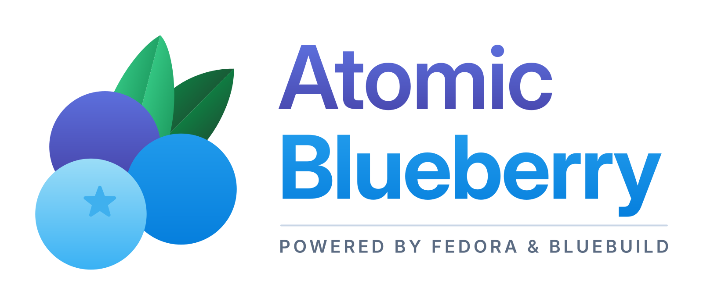

<div align="center">



[](https://github.com/Krosseye/atomic-blueberry/actions/workflows/build.yml)

</div>

## About

> [!WARNING]
> Atomic Blueberry is experimental and anything may change. It is not intended for everyday use.

Atomic Blueberry is my personal [Fedora Kinoite](https://fedoraproject.org/atomic-desktops/kinoite/) (KDE) image, built on [Universal Blue](https://universal-blue.org/) with [BlueBuild](https://blue-build.org/). It's stock Fedora with the drivers and apps I use for gaming and development preinstalled, so a fresh install doesn't need setting up by hand. Others are welcome to use it.

## What's included

### Drivers and system packages

- [xone](https://github.com/dlundqvist/xone) and [xpadneo](https://github.com/atar-axis/xpadneo): Xbox controller drivers (USB/wireless dongle and Bluetooth)
- [steam-devices](https://github.com/ValveSoftware/steam-devices): udev rules for Steam controllers, Steam Deck and VR headsets
- [v4l2loopback](https://github.com/umlaeute/v4l2loopback): needed for the OBS virtual camera
- [VSCodium](https://vscodium.com/) (installed as an RPM, so its terminal and dev containers work with the host)
- gh, git-lfs, fastfetch, Papirus icon theme, Valve's Vapor theme
- FiraCode and Symbols Nerd Fonts

### Flatpaks

These are installed from [Flathub](https://flathub.org/) on first boot.

- **General:** Firefox, Chromium, Okular, Kiview, ONLYOFFICE, Kdenlive, Haruna, Bottles, OBS Studio (with the Vulkan game capture plugin)
- **Gaming:** Steam, Heroic Games Launcher, ProtonUp-Qt, Protontricks, plus the gamescope and vkBasalt Vulkan layers
- **Development:** BoxBuddy (for Distrobox, which ships with the base image), GNOME Boxes (for virtual machines)

## Installation Options

> [!IMPORTANT]  
> AMD and Intel users should use `ghcr.io/krosseye/atomic-blueberry`, and Nvidia users should use `ghcr.io/krosseye/atomic-blueberry-nvidia`.
> The Nvidia image uses Nvidia's open kernel driver, which needs a GTX 16 series, RTX 20 series or newer card. Older cards (GTX 10 series and earlier) are not supported.

### Rebase

To rebase an existing atomic Fedora installation to the latest build of Atomic Blueberry:

1. Install the unsigned image to update keys and policies:

```bash
rpm-ostree rebase ostree-unverified-registry:ghcr.io/krosseye/atomic-blueberry:latest
systemctl reboot
```

2. Complete the rebase with the signed image:

```bash
rpm-ostree rebase ostree-image-signed:docker://ghcr.io/krosseye/atomic-blueberry:latest
systemctl reboot
```

For NVIDIA, use `atomic-blueberry-nvidia` in both commands.

### ISO

> [!IMPORTANT]  
> **Pre-built ISOs are currently not available, this is planned for the future.**

If built on Fedora Atomic, you can generate an offline ISO with the [BlueBuild CLI](https://blue-build.org/how-to/generate-iso/):

```bash
sudo bluebuild generate-iso --iso-name atomic-blueberry.iso image ghcr.io/krosseye/atomic-blueberry
```

## Verification

These images are signed with [Sigstore](https://www.sigstore.dev/)'s [cosign](https://github.com/sigstore/cosign). You can verify the signature by downloading the `cosign.pub` file from this repo and running the following command:

```bash
cosign verify --key cosign.pub ghcr.io/krosseye/atomic-blueberry
```
